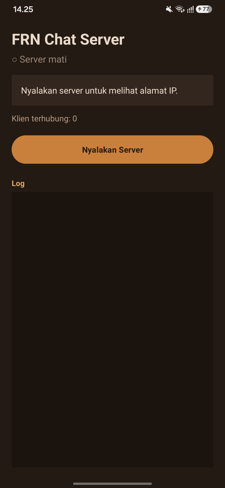
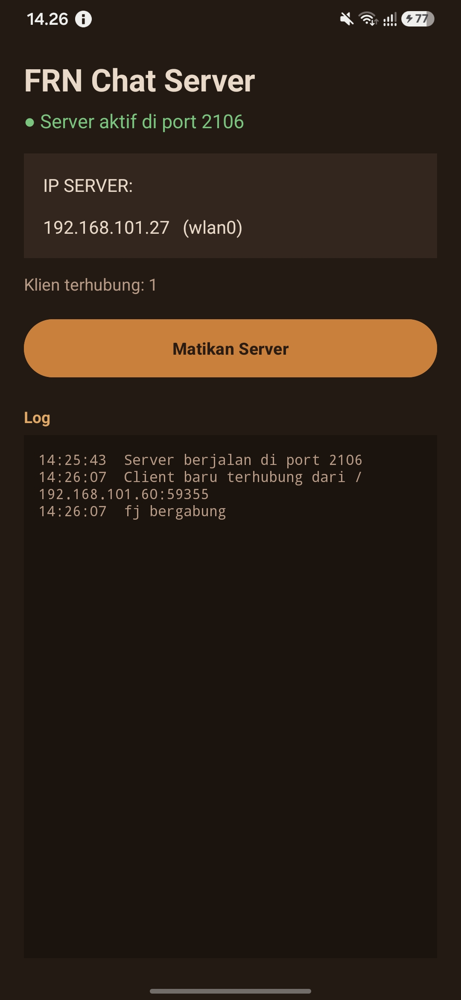

# FRN Chat Server (Android)

Turn an Android phone into the server for [FRN Chat](https://github.com/FajarRahmadani/FRNChatKotlin). The app relays messages between all connected clients. Messages are already encrypted on the client side, so the server never reads their content.

Works with the Android client ([FRNChatKotlin](https://github.com/FajarRahmadani/FRNChatKotlin)) and the desktop client ([FRN-Chat](https://github.com/FajarRahmadani/FRN-Chat)).

## Screenshots

| Server off | Server running |
|:---:|:---:|
|  |  |

## Features

- Start and stop the server with one button
- Shows the phone's IP address (Wi-Fi or hotspot) to enter in the chat clients
- Shows the number of connected clients and a live activity log
- Runs as a foreground service, so the server keeps running when the screen is off or the app is closed

## Download

Download `FRNChatServer-v1.0.apk` from [Releases](https://github.com/FajarRahmadani/FRNChatServer/releases/latest) and install it. Android will ask you to allow installing from an unknown source; this is normal for apps outside the Play Store.

## How to Use

1. Open the app, tap **Nyalakan Server** (Start Server), and allow notifications when asked. The server still starts if you decline.
2. Note the IP address shown in the app (for example `192.168.43.1` when using a phone hotspot).
3. In the chat app, enter that IP address and a username, then connect.

The server listens on port **2106**. All devices must be on the same Wi-Fi network as this phone, or connected to this phone's hotspot. Do not run this server and a desktop server on the same network at the same time; clients must all connect to one server.

To chat from the same phone, install the Android client on another device, or connect the Android client to `127.0.0.1` on this phone.

## Notes

- Some public Wi-Fi networks (campus, cafe) block devices from talking to each other. If clients cannot connect, use the phone's hotspot instead.
- The server uses battery while it runs. Keep the phone charging for long sessions.

## Project Structure

```
app/src/main/java/com/example/frnchatserver/
  MainActivity.kt      # screen: start/stop, IP, client count, log
  ServerService.kt     # foreground service that keeps the server alive
  ChatServerCore.kt    # ServerSocket and message relay
  ServerHub.kt         # connects the service to the screen
```

## Run from Source

```bash
git clone https://github.com/FajarRahmadani/FRNChatServer.git
```

Open the folder in Android Studio, wait for the Gradle sync to finish, then click **Run** on a phone (Android 8.0 / API 26 or newer).

## Security

For learning and trusted local networks only. There is no authentication or TLS. Message content is protected by the clients' shared passphrase; see the client repositories for details.

## License

[MIT](LICENSE)